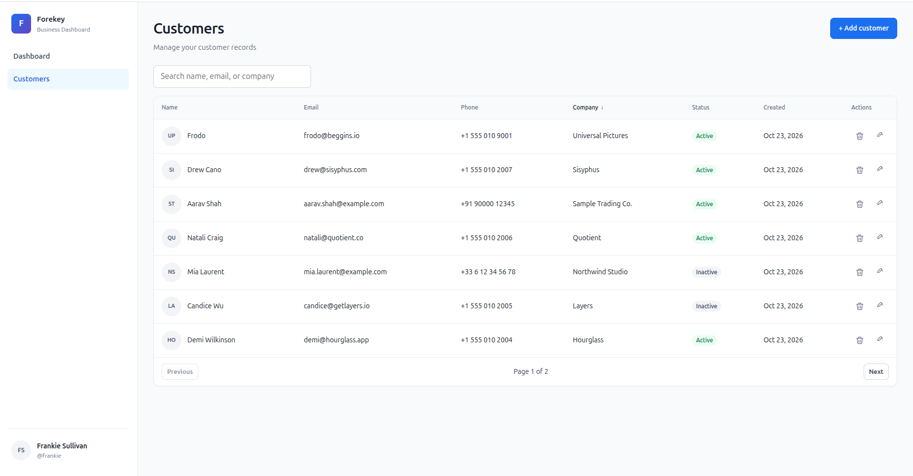
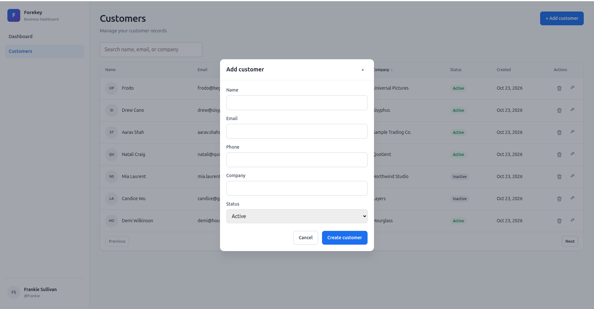
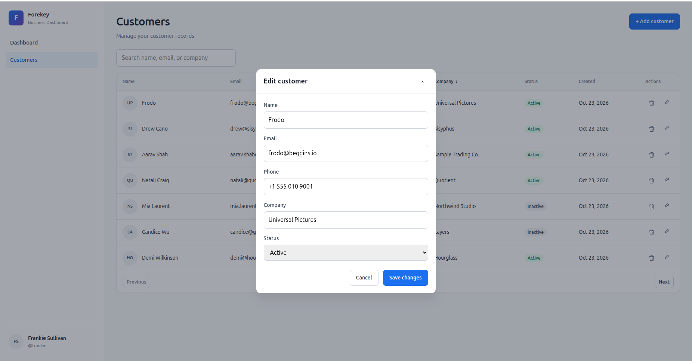

# Forekey Business Dashboard

A portfolio business admin dashboard: **React + Vite** frontend and **Laravel** REST API with fictional customer data.

## Features

- Dashboard summary cards (totals, active/inactive, new this month)
- Customer list with search, create, edit, and delete
- Server-side validation and JSON API
- SQLite by default (MySQL-ready configuration)

## Prerequisites

| Tool | Version (verified) |
|------|-------------------|
| PHP | 8.5.12 + `pdo_sqlite` |
| Composer | 2.10.3 |
| Node.js | 24.21.0 |
| npm | 11.19.0 |
| Laravel | 13.38.0 |

Install the SQLite PHP extension if needed: `sudo apt install php8.5-sqlite3` (adjust version).

## Quick start

### Backend

```bash
cd backend
composer install
cp .env.example .env
php artisan key:generate
touch database/database.sqlite
php artisan migrate --seed
php artisan serve
```

### Frontend

```bash
cd frontend
npm install
cp .env.example .env
npm run dev
```

Open [http://localhost:5173](http://localhost:5173). The API should be at [http://127.0.0.1:8000/api](http://127.0.0.1:8000/api).

## Project structure

```text
forekey-business-dashboard/
├── frontend/          React app
├── backend/           Laravel API
├── screenshots/       UI captures (see below)
└── README.md
```

See `frontend/README.md` and `backend/README.md` for details and API examples.

## Screenshots

### Customer list



### Add customer



### Edit customer



## Project status

Core implementation complete (API, database seeder, dashboard and customer UI). Screenshots above are from the local dev environment.

## About Forekey Technologies

- **Website:** https://www.forekey.in/
- **Email:** contact@forekey.in
- **GitHub:** https://github.com/forekey

Portfolio demonstration only — no production or confidential data.
